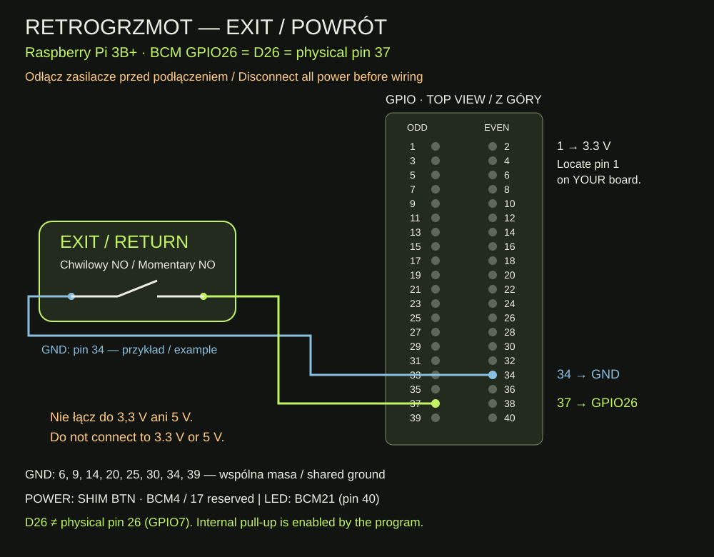

# RETROGRZMOT — EXIT button, step by step

Version 1.0.0 · 11 November 2026 · [Polski](README.md)

**SNES → game list → launch a game → press and release EXIT → the same SNES game list.** In the game list the button does nothing. It does not shut down the console.

Tested on Raspberry Pi 3 Model B+ with Batocera 43.1. Three presses confirmed GPIO26, and two game-exit tests returned to the current system’s game list. Autostart was enabled, but the console was not rebooted during these tests. Other boards and Batocera versions need separate verification. Requires Python gpiod 2.x and Batocera’s `hotkeygen --send exit`.

## 1. Parts

Prepare a working Batocera console, controller, screen, a normally-open momentary button, two wires, and a Windows computer on the same local network. For an illuminated button, use only its switch contacts. A four-pin switch may have internally joined pairs: use a meter to identify contacts that connect only while pressed.

## 2. Wire with all power disconnected

Shut down Batocera, wait for shutdown, and unplug both console and LED power supplies. Then connect:

| EXIT contact | FAN Adapter V2 | Physical Raspberry Pi pin |
| --- | --- | --- |
| First | D26 = BCM GPIO26 | 37 |
| Second | Any free GND | E.g. 34; also 6, 9, 14, 20, 25, 30, 39 |

**D26 is not physical pin 26. Physical pin 26 is GPIO7.** The tested adapter’s D26 corresponds to BCM26. Check the markings of any other adapter.



Identify pin 1 on your actual board using the [official GPIO diagram](https://www.raspberrypi.com/documentation/computers/raspberry-pi.html#gpio). The drawing looks down onto the component side, not through the underside. Follow labels and pin numbers, not wire colours.

Do not connect EXIT to 3.3 V or 5 V. The program enables the internal 3.3 V pull-up; the button shorts the input to ground. All Pi header GND pins share ground. If pin 39 is occupied by the LED wire, choose another free GND instead of pushing two connectors onto one pin.

In this build GPIO4/17 belong to OnOff SHIM, GPIO21 controls LEDs, and GPIO2/3 serve the OLED. **POWER stays on the SHIM’s BTN pads. EXIT connects directly to GPIO26 and GND.** The LED REV C fabrication schematic is unchanged; EXIT does not connect to that PCB.

Check the wiring, restore the usual power connections and wait for Batocera’s menu.

## 3. Download and copy from Windows

The ZIP is also included in this repository: [download v1.0.0](RETROGRZMOT_EXIT_v1.0.0.zip).

In the blog’s [Downloads](https://retrogrzmot.pages.dev/en/#download-exit), download EXIT v1.0.0 ZIP. Right-click it in Windows and choose **Extract All**. Open `retrogrzmot-exit-v1.0.0`; it should contain `install.sh`, `exit_button.py` and `retrogrzmot_exit`.

Find the console’s IP address in Batocera’s **Network Settings**. In File Explorer’s address bar enter `\\CONSOLE_IP\share`, replacing `CONSOLE_IP` with that address. Open `system` and copy the entire `retrogrzmot-exit-v1.0.0` folder there. If prompted, use your Batocera credentials.

If Windows blocks the network share, keep its security settings as they are. Open PowerShell in the parent folder containing `retrogrzmot-exit-v1.0.0`, replace `CONSOLE_IP`, and copy using:

```powershell
scp -r .\retrogrzmot-exit-v1.0.0 root@CONSOLE_IP:/userdata/system/
```

Enter your Batocera password and wait for the transfer to finish.

## 4. Connect over SSH

Open PowerShell in Windows. Replace `CONSOLE_IP` in this command:

```powershell
ssh root@CONSOLE_IP
```

On the first connection verify the console address and accept its host key. Enter your Batocera password; no characters appear while typing. The following commands run **on the console**, inside this SSH session. [Batocera SSH help](https://wiki.batocera.org/access_the_batocera_via_ssh).

## 5. Install

Paste this into SSH and press Enter:

```sh
bash /userdata/system/retrogrzmot-exit-v1.0.0/install.sh
```

The installer checks the Pi model, tools, Python gpiod API and GPIO26. It stops if another service owns the line. It downloads no packages, leaves `/boot/config.txt` and power-switch settings alone, and creates a unique `/userdata/system/retrogrzmot-exit-backup-…` directory. Keep the full path printed after `Backup:`.

Success prints `EXIT installed`. The installer starts EXIT and adds it to the existing enabled services, preserving OLED and LED services. It does not reboot. If any error appears, stop and read the troubleshooting section below.

## 6. Test

1. Open a console’s game list, e.g. SNES, and launch a game you can safely exit.
2. Press and release EXIT. The game should close after release and return to that system’s game list.
3. Launch the game again and repeat.
4. Press EXIT in the game list: it should neither shut down nor select a game.
5. When convenient, shut down normally, power on again and repeat the game test to verify autostart on your own console.

The program debounces for 60 ms, sends one exit on release, and waits at least two seconds between commands. A button held at startup must be released and pressed again. It does not force-kill a stuck emulator or create a save state. Save progress as you normally would before exiting.

## Troubleshooting

Run in SSH:

```sh
batocera-services status retrogrzmot_exit
tail -30 /tmp/retrogrzmot-exit.log
gpioinfo | grep GPIO26
```

`status` may print nothing. Run `echo $?` immediately afterwards: `0` means running. The log should contain `READY BCM26`, then `PRESS` and `RELEASE`, and `EXIT sent, returncode=0` after exiting a game. GPIO26 should show `retrogrzmot_exit`, `input`, `active-low` and `pull-up`. The log is in `/tmp` and clears at reboot.

- **No PRESS/RELEASE:** shut down and disconnect power before checking D26/GND wiring and the switch contacts.
- **GPIO busy:** inspect `gpioinfo`. Resolve the conflict; do not blindly disable another service.
- **Missing gpiod / wrong API:** this package requires Python gpiod 2.x, tested with Batocera 43.1 on Pi 3B+. Do not install arbitrary libraries intended for another OS.
- **Press is logged but the game stays open:** check whether the controller’s normal Hotkey + Start exits that emulator. Exit support also depends on the emulator. Do not substitute a system shutdown command.
- **Fails after reboot:** `batocera-settings-get system.services` must include `retrogrzmot_exit`. If missing, run `batocera-services enable retrogrzmot_exit` and then `batocera-services start retrogrzmot_exit`.

## Disable or restore

Run in SSH:

```sh
bash /userdata/system/retrogrzmot-exit-v1.0.0/uninstall.sh
```

This stops EXIT and disables autostart while retaining program files and backups. POWER, OLED and LED settings retain their own configuration. To enable EXIT again:

```sh
batocera-services start retrogrzmot_exit
batocera-services enable retrogrzmot_exit
```

If the installer replaced an older EXIT version, stop and disable it first. Copy `exit_button.py` and `retrogrzmot_exit` from the printed backup directory back to `/userdata/system/retrogrzmot/exit_button.py` and `/userdata/system/services/retrogrzmot_exit`, respectively. Enable it using the two commands above. The saved `batocera.conf` is an emergency backup: restoring the entire file also reverts unrelated settings changed since that backup.

## Files and references

`exit_button.py` and `retrogrzmot_exit` are the hardware-tested program and service. Repository checks validate the package’s installer/uninstaller syntax; they were not reinstalled on the console. `wiring.svg` and `wiring.md` document the connections.

- [Source on GitHub](https://github.com/lszumilak/retrogrzmot-return-button)
- [Batocera buttons and hotkeygen](https://wiki.batocera.org/diy-arcade-controls)
- [Batocera user services](https://wiki.batocera.org/launch_a_script#services)
