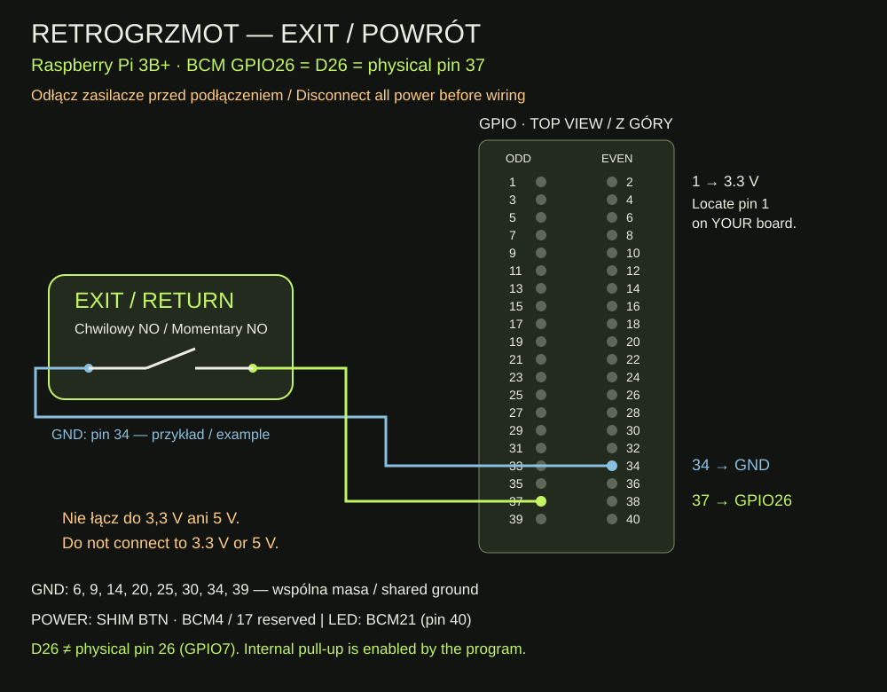

# RETROGRZMOT — przycisk EXIT, krok po kroku

Wersja 1.0.0 · 11 listopada 2026 · [English](README.en.md)

**SNES → lista gier → uruchomiona gra → naciśnij i puść EXIT → ta sama lista gier SNES.** Przycisk działa podczas gry. W menu niczego nie wybiera. Nie wyłącza konsoli.

Sprawdzone na Raspberry Pi 3 Model B+ z Batocerą 43.1. Trzy naciśnięcia potwierdziły sygnał GPIO26, a dwie próby w grze zakończyły się powrotem do listy bieżącej konsoli. Autostart został zapisany, ale podczas tych prób nie restartowaliśmy urządzenia. Inne modele Pi i wersje Batocery wymagają osobnego sprawdzenia. Kod używa Python gpiod 2.x i standardowego polecenia Batocery `hotkeygen --send exit`.

## 1. Przygotuj części

- Działająca Batocera, pad i telewizor.
- Przycisk chwilowy, normalnie otwarty (NO): zwiera dwa styki tylko podczas naciskania.
- Dwa przewody do przycisku i dostęp do GPIO Raspberry Pi lub FAN Adapter V2.
- Komputer Windows w tej samej sieci lokalnej co konsola.

Przycisk podświetlany może mieć osobne styki do lampki. Ten poradnik dotyczy wyłącznie styków przełącznika. Przy przycisku czteropinowym sprawdź miernikiem, która para zwiera się dopiero po naciśnięciu.

## 2. Podłącz przy odłączonym zasilaniu

Zamknij Batocerę z menu, poczekaj na zakończenie pracy i odłącz zasilacze konsoli oraz LED. Dopiero wtedy podłącz przewody:

| Styk przycisku EXIT | FAN Adapter V2 | Raspberry Pi, numer fizyczny |
| --- | --- | --- |
| Pierwszy | D26 = BCM GPIO26 | 37 |
| Drugi | Dowolne GND | Np. 34; również 6, 9, 14, 20, 25, 30, 39 |

**D26 nie oznacza fizycznego pinu 26. Fizyczny pin 26 to GPIO7.** Na użytym adapterze D26 potwierdzono testem jako BCM26. Przy innym adapterze sprawdź jego opis.



Zlokalizuj pin 1 na swojej płytce według [dokumentacji Raspberry Pi](https://www.raspberrypi.com/documentation/computers/raspberry-pi.html#gpio). Schemat to widok na złącze od strony elementów, nie od spodu. Używaj numerów i oznaczeń; kolory przewodów są dowolne.

Nie łącz EXIT do 3,3 V ani 5 V. Podciąganie wejścia do 3,3 V włącza program; przycisk zwiera je do masy. GND na złączu Pi mają wspólną masę. Jeśli pin 39 zajmuje już przewód LED, wybierz inne wolne GND — nie wciskaj dwóch końcówek w jedno gniazdo.

W RetroGrzmocie GPIO4 i GPIO17 zajmuje OnOff SHIM, GPIO21 steruje LED, GPIO2 i GPIO3 służą OLED. **Przycisk POWER zostaje na polach BTN SHIM-a. EXIT podłącz bezpośrednio do GPIO26 i GND.** Schemat produkcyjny PCB LED REV C pozostaje aktualny: EXIT nie jest podłączany do tej płytki.

Sprawdź przewody, podłącz zasilanie jak dotychczas i poczekaj na menu Batocery.

## 3. Pobierz i rozpakuj paczkę na komputerze

Paczka ZIP jest też w katalogu głównym tego repozytorium: [pobierz v1.0.0](RETROGRZMOT_EXIT_v1.0.0.zip).

W [sekcji Do pobrania na blogu](https://retrogrzmot.pages.dev/pl/#download-exit) wybierz „Pobierz EXIT v1.0.0 (ZIP)”. W Windows kliknij pobrany plik prawym przyciskiem i wybierz **Wyodrębnij wszystkie**. Otwórz rozpakowany folder `retrogrzmot-exit-v1.0.0`. Powinny być w nim m.in. `install.sh`, `exit_button.py` i `retrogrzmot_exit`.

W pasku adresu Eksploratora wpisz `\\ADRES_KONSOLI\share`, zastępując `ADRES_KONSOLI` adresem IP odczytanym w Batocerze: **Ustawienia sieci**. Otwórz folder `system` i skopiuj do niego cały folder `retrogrzmot-exit-v1.0.0`. Jeśli Windows poprosi o logowanie, użyj danych swojej Batocery. [Pomoc dotycząca udostępnionego folderu](https://wiki.batocera.org/access_the_batocera_via_ssh).

Jeśli Windows odmawia otwarcia udziału sieciowego, nie zmieniaj zabezpieczeń Windows. Otwórz PowerShell w folderze nadrzędnym rozpakowanej paczki (widać w nim folder `retrogrzmot-exit-v1.0.0`) i skopiuj ją tym poleceniem, podstawiając IP konsoli:

```powershell
scp -r .\retrogrzmot-exit-v1.0.0 root@ADRES_KONSOLI:/userdata/system/
```

Podaj hasło Batocery i poczekaj na zakończenie kopiowania.

## 4. Połącz się przez SSH

Otwórz PowerShell na komputerze. W poniższym poleceniu zastąp `ADRES_KONSOLI` tym samym adresem IP:

```powershell
ssh root@ADRES_KONSOLI
```

Przy pierwszym połączeniu sprawdź adres konsoli i potwierdź klucz. Wpisz swoje hasło Batocery; podczas wpisywania nie widać znaków. Po zalogowaniu kolejne polecenia wykonują się **na konsoli**, a nie w Windows.

## 5. Zainstaluj

Skopiuj do okna SSH poniższe polecenie i naciśnij Enter:

```sh
bash /userdata/system/retrogrzmot-exit-v1.0.0/install.sh
```

Instalator sprawdza model Raspberry Pi, narzędzia i GPIO26. Jeśli pin jest zajęty przez inną usługę, zatrzymuje instalację. Nie pobiera pakietów i nie zmienia `/boot/config.txt` ani ustawień zasilania. Tworzy osobny katalog kopii `/userdata/system/retrogrzmot-exit-backup-…`, a jego pełną nazwę wypisuje w wierszu `Backup:`. Zachowaj tę nazwę.

Po powodzeniu zobaczysz `EXIT installed`. Instalator uruchamia usługę i dopisuje ją do istniejących usług Batocery, zachowując OLED i LED. Nie uruchamia konsoli ponownie. Gdy pojawi się błąd, zatrzymaj się i sprawdź część „Jeśli coś nie działa”.

## 6. Sprawdź działanie

1. Wejdź np. do SNES i uruchom grę, którą możesz teraz zamknąć.
2. Naciśnij i puść EXIT. Po puszczeniu gra powinna się zamknąć i pokazać listę gier SNES.
3. Uruchom grę ponownie i powtórz próbę.
4. W samej liście gier naciśnij EXIT: nie powinno nastąpić wyłączenie ani wybór gry.
5. Kiedy będziesz gotowy, zamknij konsolę normalnie i włącz ją ponownie. Powtórz próbę w grze, aby potwierdzić autostart na swoim urządzeniu.

Program filtruje drgania styków przez 60 ms i wywołuje wyjście raz po puszczeniu. Między poleceniami jest co najmniej 2 sekundy przerwy. Przytrzymanie przycisku podczas startu nie wyzwala wyjścia — trzeba go puścić i nacisnąć ponownie. Nie wymusza zakończenia zawieszonego emulatora i nie wykonuje zapisu stanu gry. Zapisz postęp tak jak przed zwykłym wyjściem z gry.

## Jeśli coś nie działa

Poniższe polecenia wykonuj w SSH:

```sh
batocera-services status retrogrzmot_exit
tail -30 /tmp/retrogrzmot-exit.log
gpioinfo | grep GPIO26
```

`status` może niczego nie wypisać przy poprawnym działaniu. Aby zobaczyć kod wyniku, bezpośrednio po nim wykonaj `echo $?`: `0` oznacza działającą usługę. W logu powinien być wpis `READY BCM26`, a po naciśnięciu `PRESS` i `RELEASE`. Przy wyjściu z gry pojawia się `EXIT sent, returncode=0`. `gpioinfo` powinno wskazywać `retrogrzmot_exit`, `input`, `active-low` i `pull-up`.

- **Brak PRESS/RELEASE:** sprawdź przewody D26/GND i styki przycisku, po uprzednim zamknięciu systemu i odłączeniu zasilania.
- **GPIO26 is already used / Device or resource busy:** nie wyłączaj obcej usługi w ciemno. Sprawdź `gpioinfo` i usuń konflikt przed dalszą instalacją.
- **Brak gpiod lub niewłaściwe API:** ta paczka wymaga Python gpiod 2.x; nie instaluj losowych bibliotek z poradników dla innych systemów. Punktem odniesienia jest Batocera 43.1 na Pi 3B+.
- **Przycisk jest widoczny w logu, ale gra nie wychodzi:** sprawdź, czy zwykły skrót pada Hotkey + Start zamyka tę grę. Obsługa wyjścia zależy także od emulatora. Nie zastępuj polecenia wyjścia komendą wyłączenia systemu.
- **Działało przed restartem:** sprawdź `batocera-settings-get system.services`. Na liście musi być `retrogrzmot_exit`. W razie braku wykonaj `batocera-services enable retrogrzmot_exit`, a następnie `batocera-services start retrogrzmot_exit`.

Log znajduje się w `/tmp` i znika po restarcie.

## Jak wyłączyć lub przywrócić starszą wersję

Aby zatrzymać obsługę i wyłączyć autostart, w SSH wykonaj:

```sh
bash /userdata/system/retrogrzmot-exit-v1.0.0/uninstall.sh
```

Pliki i kopie zostają na karcie. Przycisk POWER oraz OLED/LED zachowują własne ustawienia. Aby ponownie włączyć EXIT, wykonaj:

```sh
batocera-services start retrogrzmot_exit
batocera-services enable retrogrzmot_exit
```

Jeśli instalator aktualizował wcześniejszą wersję EXIT, zatrzymaj i wyłącz usługę jak wyżej. W katalogu `Backup:` znajdziesz wcześniejsze `exit_button.py` i `retrogrzmot_exit`. Skopiuj je odpowiednio do `/userdata/system/retrogrzmot/exit_button.py` i `/userdata/system/services/retrogrzmot_exit`, następnie włącz usługę powyższymi dwoma poleceniami. Kopia `batocera.conf` jest awaryjna: przywrócenie całego pliku cofnie także inne ustawienia zmienione później.

## Pliki i źródła

- `exit_button.py` — kod użyty w dwóch udanych próbach na urządzeniu.
- `retrogrzmot_exit` — obsługa start/stop/status/restart.
- `install.sh`, `uninstall.sh` — przygotowane dla tej paczki; ich składnię sprawdzają automatyczne kontrole repozytorium, bez ponownej instalacji na konsoli.
- `wiring.svg`, `wiring.md` — schemat i rozpiska połączeń.
- [Kod na GitHubie](https://github.com/lszumilak/retrogrzmot-return-button)
- [Batocera: własne przyciski i hotkeygen](https://wiki.batocera.org/diy-arcade-controls)
- [Batocera: usługi użytkownika](https://wiki.batocera.org/launch_a_script#services)
- [Batocera: SSH](https://wiki.batocera.org/access_the_batocera_via_ssh)
