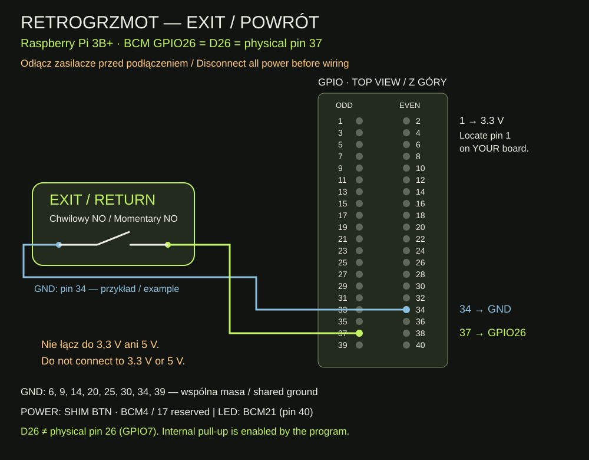

# EXIT — połączenia / wiring

Raspberry Pi 3B+ · Batocera 43.1 · 2026-11-11

| Funkcja / Function | BCM GPIO | Pin fizyczny / physical | Połączenie / connection |
| --- | --- | --- | --- |
| EXIT | 26 | 37 | D26 → styk przycisku / switch contact |
| EXIT GND | — | Np. / e.g. 34 | Drugi styk → wolne GND / other contact → free GND |
| POWER OnOff SHIM | 17 i / and 4 | 11 i / and 7 | Zarezerwowane / reserved; POWER → BTN SHIM |
| LED DATA | 21 | 40 | D21 → J3 pin 2 PCB LED REV C |
| LED GND | — | 39 w schemacie / in drawing | GND → J3 pin 1; inne GND też wspólne / GND is shared |
| OLED SDA / SCL | 2 / 3 | 3 / 5 | I²C |
| OLED VCC / GND | — | 1 / 6 | 3,3 V / GND |

PL: Przycisk NO, chwilowy, zwiera BCM26 do masy. Podłączaj przy odłączonych zasilaczach. Program ustawia wejście i wewnętrzny pull-up; nie łącz przycisku do 3,3 V ani 5 V. Wszystkie GND złącza Pi mają wspólną masę. D26 oznacza tutaj BCM26, nie fizyczny pin 26. Przycisk EXIT nie łączy się z PCB LED ani polami BTN SHIM-a. Numer użytego przez właściciela GND nie był ustalany; pin 34 na rysunku jest przykładem wolnego GND.

EN: A normally-open momentary switch connects BCM26 to ground while pressed. Disconnect all power before wiring. The program sets an input with an internal pull-up; do not connect the switch to 3.3 V or 5 V. All Pi header GND pins share ground. D26 here means BCM26, not physical pin 26. EXIT connects to neither the LED PCB nor the SHIM BTN pads. The owner’s exact GND pin was not recorded; pin 34 in the drawing is an example of a free GND.

[Pełna instrukcja PL](README.md) · [Full English guide](README.en.md)
